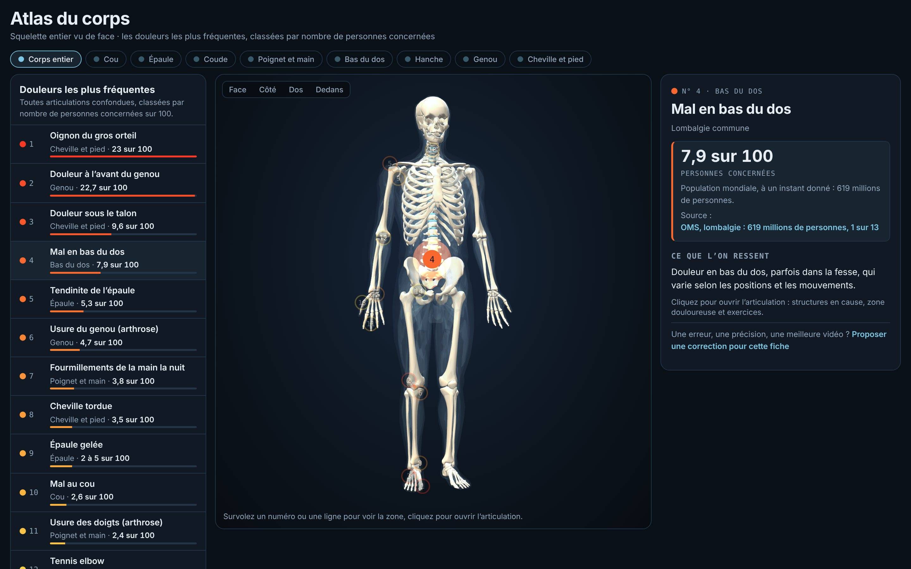
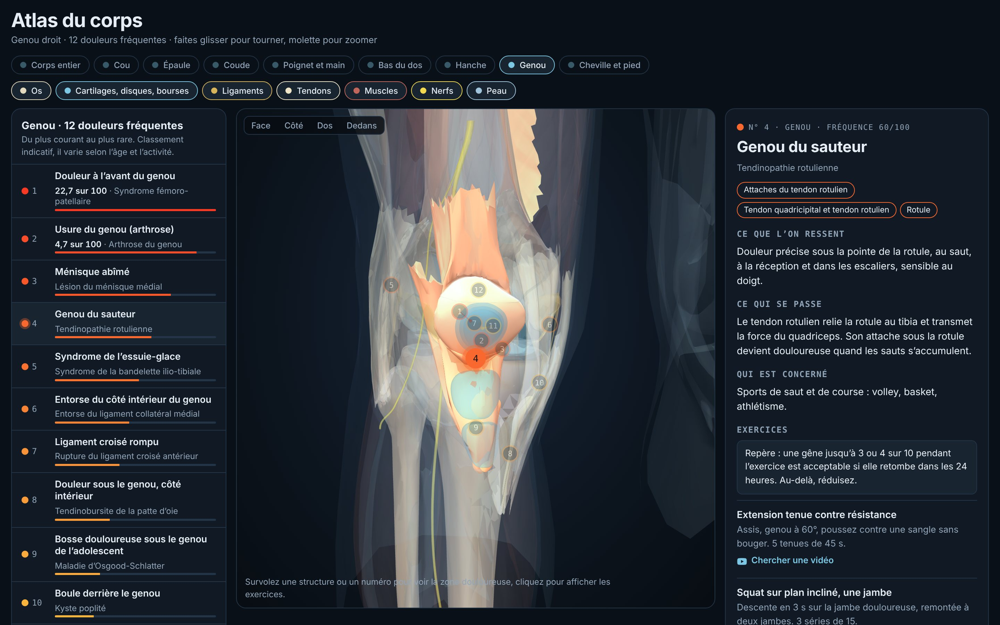
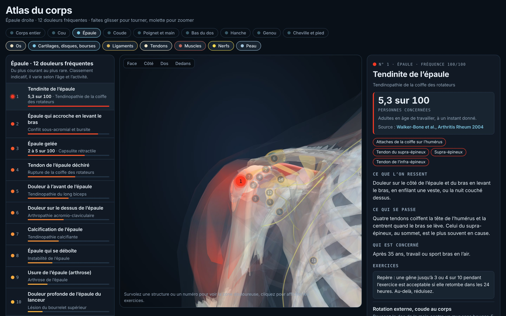
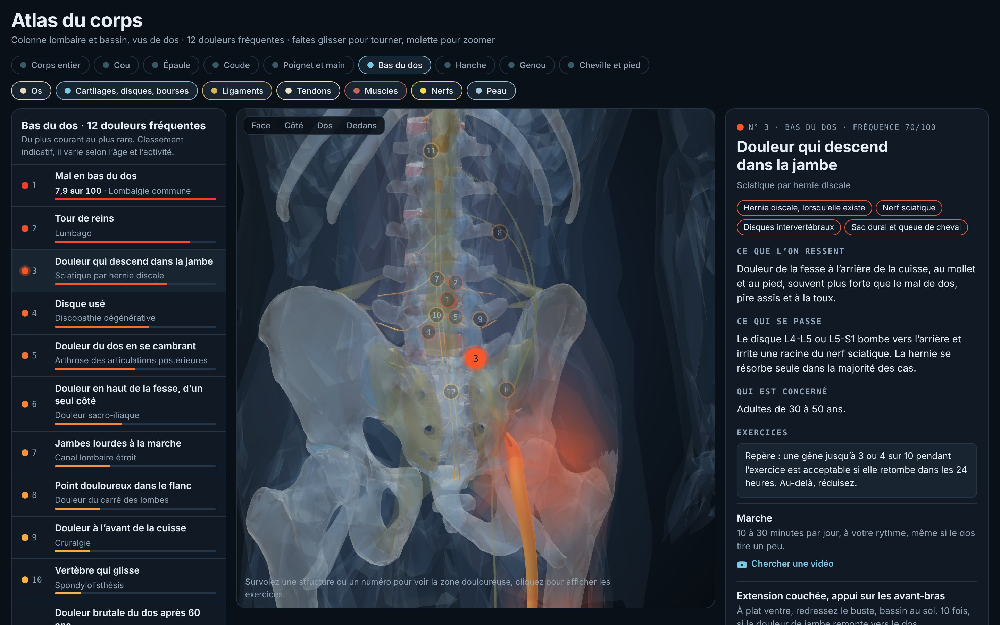

# Atlas du corps

**Un atlas 3D interactif, en français, des douleurs articulaires et du dos fréquentes : où elles se situent, quelles structures elles concernent, et quels exercices sont souvent proposés.**

> **Information générale, pas un avis médical.** Le code et les textes ont été écrits avec Claude, un modèle d’IA d’Anthropic, et **les fiches n’ont pas encore été relues par des professionnels de santé**. L’atlas ne pose pas de diagnostic. Urgence : **15** ou **112**.
>
> **Relecteurs recherchés** : kinésithérapeutes, médecins, étudiants en santé. Voir [comment relire](MEDICAL_REVIEW.md).

**[Ouvrir l'atlas](https://bobbuilds398.github.io/atlas-whole-body/)** · [English version](https://bobbuilds398.github.io/atlas-whole-body/?lang=en) · [À propos et avertissements](https://bobbuilds398.github.io/atlas-whole-body/a-propos.html) · [Proposer une correction](https://github.com/bobbuilds398/atlas-whole-body/issues/new/choose) · [Contribuer](CONTRIBUTING.md) · [English summary](#english-summary)



## Ce que fait l'atlas

- **Corps entier.** Un squelette en 3D et les douleurs les plus fréquentes, regroupées par ordre de grandeur du nombre de personnes concernées. Chaque chiffre vient d'une étude publiée, citée dans la fiche avec ce qu'elle mesure : à un instant donné ou sur une année, âges, pays. Ces études ne sont pas directement comparables, c'est pourquoi l'atlas montre des groupes plutôt qu'un classement exact.
- **Huit articulations détaillées** : cou, épaule, coude, poignet et main, bas du dos, hanche, genou, cheville et pied. Pour chacune, les 12 douleurs les plus fréquentes (13 pour la hanche).
- **Anatomie réelle.** Os, cartilages, ligaments, tendons, muscles et nerfs issus de [Z-Anatomy](https://github.com/Z-Anatomy/Models-of-human-anatomy), avec une couche par type de structure.
- **Zone douloureuse.** La structure en cause est mise en évidence, et la zone où l'on ressent la douleur est peinte sur la peau.
- **Filtres en langage courant.** « Zone de la douleur », « Moment ou geste » : les fiches qui mentionnent ces repères restent en clair, sans changer l'ordre de la liste. Ce n'est pas un diagnostic.
- **Signes d'alerte et exercices.** Chaque fiche commence par les signes qui doivent faire consulter, puis propose quelques exercices souvent utilisés en rééducation, avec leurs consignes et un repère de douleur acceptable.

| Genou | Épaule | Bas du dos |
| --- | --- | --- |
|  |  |  |

## État du projet, et où l'aide est la plus utile

Ce projet est jeune. Ses limites sont connues, et ce sont autant de façons d'aider.

- **Les fiches n'ont pas été relues par des professionnels de santé.** Le code et les textes (fiches, exercices, signes d’alerte) ont été écrits avec Claude, un modèle d’IA d’Anthropic, à partir de connaissances générales, puis relus et publiés par le mainteneur, qui n’est pas professionnel de santé. Le site affiche l'état de relecture de chaque fiche. **Relecteurs recherchés** : kinésithérapeutes, médecins du sport, rhumatologues, étudiants en santé ([politique de relecture](MEDICAL_REVIEW.md)).
- **Le classement dans chaque articulation est une estimation.** Il ne repose pas sur des chiffres publiés et varie selon l'âge et le sport. Des données par articulation (consultations de médecine générale, suivis de sportifs) seraient précieuses.
- **Les vidéos sont des recherches YouTube, non vérifiées.** Chaque exercice mériterait un lien vers une vidéo précise, regardée en entier par un professionnel.
- **Quelques douleurs fréquentes manquent** : goutte, luxation de la rotule, arthrose du gros orteil sur le corps entier, douleur du grand trochanter sur le corps entier. Chacune demande un placement 3D.
- **Le site pèse environ 23 Mo** (modèles en base64) et utilise three.js r128 (2021).
- **L'anatomie est celle d'un seul individu**, en position debout. Quelques structures sont schématiques : bourse de l'olécrâne, nerf grand occipital, et les éléments « lorsqu'ils existent » (hernie discale, kyste synovial, névrome de Morton, dépôt calcaire).
- **La hanche utilise un moteur à part**, plus ancien, avec ses propres réglages (mouvement, coupe, exercices par phase).
- **Le site est en français et en anglais.** La langue suit celle du navigateur (bouton pour changer). Le texte anglais est une traduction faite avec la même IA ; en cas de différence, le français fait foi. Relecteurs anglophones bienvenus.

L'atlas est un outil d'information. Il ne remplace pas l'avis d'un médecin ou d'un kinésithérapeute.

## Feuille de route

1. Relecture des fiches par des professionnels, en commençant par les signes d’alerte.
2. Sources pour chaque fiche, et vidéos vérifiées.
3. Hanche intégrée au moteur commun, textes dans `content/hanche.json`.
4. Scripts de modèles reproductibles.
5. Relecture de la version anglaise, autres langues.

## Contribuer

Vous n'avez pas besoin de savoir programmer.

- **Une erreur dans une fiche ?** Chaque fiche du site a un lien « Proposer une correction », qui ouvre un formulaire prérempli. Vous pouvez aussi [choisir un formulaire ici](https://github.com/bobbuilds398/atlas-whole-body/issues/new/choose).
- **Envie de corriger vous-même ?** Les textes sont dans des fichiers lisibles, un par articulation : [`content/genou.json`](content/genou.json), [`content/epaule.json`](content/epaule.json)… Sur GitHub, le crayon en haut du fichier permet de le modifier et de proposer le changement.
- **Développeur ?** Le site est statique, sans étape de construction : HTML, CSS, JavaScript et three.js.

Le guide complet est dans [CONTRIBUTING.md](CONTRIBUTING.md).

## Lancer le site en local

```bash
git clone https://github.com/bobbuilds398/atlas-whole-body.git
cd atlas-whole-body
python3 -m http.server 8000
```

Puis ouvrez <http://localhost:8000>. La page doit être servie par un serveur web : ouverte directement comme fichier, elle ne peut pas charger ses données.

## Organisation du dépôt

| Dossier | Contenu |
| --- | --- |
| `index.html`, `a-propos.html`, `css/`, `js/` | La page, la page « À propos », les styles, et les deux scripts : `js/atlas.js` (corps entier et articulations) et `js/hip.js` (hanche). |
| `vendor/` | three.js r128 et les polices, servis par le site lui-même (aucune requête vers un tiers). |
| `content/` | Les textes : fiches, exercices, questions, chiffres et sources. Un fichier JSON par articulation, plus `corps.json` pour la vue d'ensemble. `content/en/` contient le texte anglais, avec les mêmes identifiants. |
| `models/` | Les modèles 3D et le placement des douleurs, un fichier par articulation. |
| `tools/` | `check-content.mjs` vérifie la cohérence des contenus. `models/` garde, pour référence, les scripts qui ont produit les modèles. |
| `docs/` | Images de ce README. |

## Licences et crédits

- **Code** (`index.html`, `a-propos.html`, `css/`, `js/`, `tools/`) : [licence MIT](LICENSE).
- **Contenus et modèles 3D** (`content/`, `models/`, `docs/`, textes de `js/hip.js`, fichiers `.md`) : [CC BY-SA 4.0](LICENSE-CONTENT.md). Le détail par fichier est dans [`REUSE.toml`](REUSE.toml).
- Les modèles 3D sont dérivés de **Z-Anatomy** — The libre 3D atlas of anatomy — CC BY-SA 4.0 (Gauthier Kervyn et al.), lui-même dérivé de **BodyParts3D** — © The Database Center for Life Science — CC BY-SA 2.1 Japon (la base est aujourd’hui diffusée sous CC BY 4.0).
- Rendu 3D : [three.js](https://threejs.org/) (MIT). Polices : Bricolage Grotesque, Public Sans, IBM Plex Mono (SIL OFL 1.1).
- Pour citer l'atlas : [`CITATION.cff`](CITATION.cff). Historique : [`CHANGELOG.md`](CHANGELOG.md). Conduite : [`CODE_OF_CONDUCT.md`](CODE_OF_CONDUCT.md). Failles : [`SECURITY.md`](SECURITY.md).

## English summary

**General information, not medical advice.** Code and texts were written with an AI model (Claude, by Anthropic) and published by a non-clinician maintainer; the cards have **not yet been reviewed by health professionals**. The atlas does not diagnose. We are looking for physiotherapist and physician reviewers: see [MEDICAL_REVIEW.md](MEDICAL_REVIEW.md).

**Atlas du corps** is an interactive 3D atlas of the most common joint and back pain, in French. A whole-body view groups conditions by order of magnitude of people affected, using published figures cited on each card; the studies differ in what they measure (point prevalence, yearly new cases, painless deformity), age range and country, so the order within a group is not meaningful. Eight detailed views (neck, shoulder, elbow, wrist and hand, lower back, hip, knee, ankle and foot) each show their 12 most common conditions with real anatomy from Z-Anatomy, the structure involved, the area where pain is felt, and a few exercises with warning signs.

**Help wanted.** The medical content has not been reviewed by health professionals yet, the per-joint orderings are estimates without published figures, and exercise videos are unverified YouTube searches. Reviews from physiotherapists and physicians are the most valuable contribution. The site is also available in English ([open in English](https://bobbuilds398.github.io/atlas-whole-body/?lang=en)); it follows the browser language and has a switch. The English text is an AI translation of the French original and lives in `content/en/` (same ids as the French files) and `js/hip-en.js`; reviews by English-speaking clinicians are welcome.

You can open an issue in English with one of the [issue forms](https://github.com/bobbuilds398/atlas-whole-body/issues/new/choose), or read [CONTRIBUTING.md](CONTRIBUTING.md) (it has an English section). The site is static, with no build step: clone it, run `python3 -m http.server`, and open the page.

Code is MIT-licensed; content and 3D data are CC BY-SA 4.0. This is an information tool, not medical advice.
